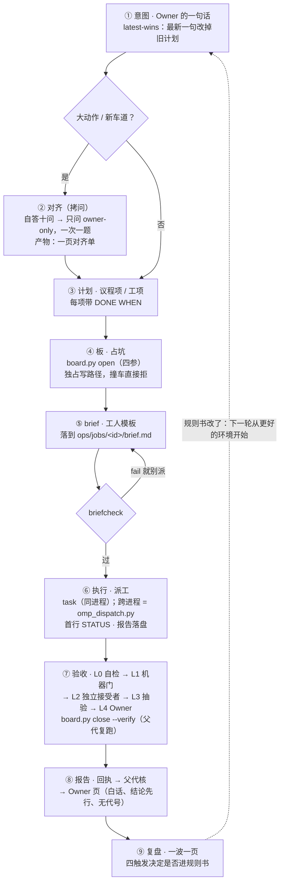

<!-- source: AgentRule/skills.md @ bb4b0a7f -->
# Skills 导览
> EN: Which skill to think of, and when: the routing table and the main-line flow from intent to retro.
<!-- summary: 什么时候该有 skill、下一步接哪一步；具体名字以本机目录为准。 -->

> 伴生工具：本页提到的 `<run_all_gates.py, omp_dispatch.py>` 不在本仓库。这里给的是格式与判据，不是可直接跑的命令。

> 这一页只回答两个问题：**什么时候该有 skill**，**下一步接哪一步**。
> 各家 skill 目录在哪、frontmatter 怎么写、怎么调用 → `adapters/<harness>.md`；具体有哪些 skill 以 `ls <skills-dir>` 的输出为准，不在本页背名字。

## 为什么需要这一页

skill 的 `description` 只在**被检索到**时起作用——不知道自己缺什么，就根本不会去找。
所以判据不是「skill 写得好不好」，是「**触发条件有没有写在能被检索到的地方**」。

## 什么时候该有 skill（四条，全中才做）

| # | 判据 | 反例 |
|---|---|---|
| 1 | 同一段流程走过 ≥3 次，每次都要重新解释一遍 | 只跑一次的事 |
| 2 | 触发条件是分支式的（「当 X 且 Y 时」），不是「总是」 | 一句话能答的事 |
| 3 | 出口可判：一条命令 / 一个文件 / 一张填好的表 | 只有描述、没有出口 |
| 4 | 内容放不进常驻提示（放得进就放常驻，少一层跳转） | 常驻三行就能说完 |

四条缺一条就别做成 skill——**多一层跳转本身就是成本**。
反面判据：做完发现「这个 skill 干的事我自己也会做，只是多查了一页」→ 该收成常驻的一行，而不是加一个 skill。

## description 写分支，不写简介

- `description` 占每轮成本、只帮「发现」——列「什么时候用」的条件，不写内容摘要。
- 模型要能自己找到（或别的 skill 要拉它）→ 常驻 description，写**触发分支**；只人手动的 → 隐藏（零常驻成本，但吃认知负载，必须靠一页索引补发现）。
- 组合型 skill = **一行壳**（「调 X 和 Y」）；重内容住原语，不住壳里。

## 主线流图（下一步接哪一步）

> 上面答「什么时候该有 skill」，这张图答「**下一步接哪一步**」。图上每步都住在一个文件里；那一步的细则开对应那页。

**每步住哪**：

| 步 | 做什么 | 住哪 | 出口 |
|---|---|---|---|
| ① 意图 | Owner 一句话（latest-wins）；开工前先读 `library/floor/incidents.md` | 原话归档：本线 `OWNER-OPS-INTENT.md`；方向：项目 `AGENTS.md`；开工六问：`library/floor/hard-floor.md` | 听懂、边界清；大动作 → 走 ② |
| ② 对齐 | 拷问：自答十问，只问 owner-only（一次一题） | 产物 = 对齐单（当前线 ops 目录）；拷问判据见 `library/dispatch/writing-for-agents.md` | 对齐单落盘；Owner 确认后才动手 |
| ③ 计划 | 议程项 / 工项；每项带 `DONE WHEN` | 本线 `PLAN-V1.md` | 工项切得能派（垂直、自足、`briefcheck` 可过） |
| ④ 板 | 占坑：独占写路径声明 | `board.py`（`~/.owner/ops/board.md`，append-only） | 成功占坑（撞车直接拒） |
| ⑤ brief | 工人模板 | 模板 = `library/dispatch/dispatch.md`；档 = `ops/jobs/<id>/brief.md` | `briefcheck` 过（fail 就别派） |
| ⑥ 执行 | 派工；工人自足作业 | 同进程 `task`；跨进程 `omp_dispatch.py`（`run`/`resume`/`status`；该工具不在本仓库，见页首「伴生工具」）；契约 = `library/dispatch/dispatch.md` | 工人首行 `STATUS`；报告落盘 |
| ⑦ 验收 | L0 自检 → L1 机器门 → L2 独立接受者 → L3 抽验 → L4 Owner | `library/dispatch/dispatch.md §自审`（四段）；`run_all_gates.py`（套数以它自己打印的清单为准；该工具不在本仓库）；`board.py close --verify`（父代复跑） | 全部 `close`；VERIFY 收据在 |
| ⑧ 报告 | 回执核完 → Owner 页 | 工人最终答复 / `ops/jobs/<id>/`；`OWNER-REPORT.md`；形状 = `library/dispatch/reply-shape.md` | Owner 页：白话、结论先行、无代号、带可跑入口 |
| ⑨ 复盘 | 一波一页；四触发决定是否进规则书 | `library/recovery/retro.md`；四触发 = `library/README.md` | 候选清单（默认不动手） |

**三句一句话答案（照图答）**：

- **计划到派发中间要过哪几步**：切工项（带 `DONE WHEN`）→ 占坑（`board.py open` 四参）→ 写 brief（按 `library/dispatch/dispatch.md` 的模板）→ `briefcheck` 过 → 派（同进程 `task`；跨进程 `omp_dispatch.py`）。
- **一波活从哪开始到哪结束**：Owner 一句话（①）→（大动作才走 ② 对齐）→ ③…⑨；收工 = 板全关 ＋ 报告落盘 ＋ 复盘一页。
- **卡住了去哪**：断链 / 压缩 / 换会话 → `library/recovery/recovery.md`（三栏板）；派发协议 → `library/dispatch/dispatch.md`；规矩入口 → 本页 §主线流图 → `library/README.md`。

### 阶段边界

到一步的边界时按序选（先便宜、先无损）：**继续** → **换会话**（先写交接）→ **派工人** → **压缩**（垫底——压平的决定会让新会话自信地错）。判据：`library/recovery/recovery.md`（压缩过 2 次或跨天 → 照常继续；不主动向 Owner 提切换）＋ 各家自己的自动压缩阈值。边界决策只在边界做；中途只准「继续」或把剩下的拆成工人。

## 一条判据

**skill 的 `description` 决定「你能不能想起它」，一页索引决定「你想不想得起它」。**
两个都做好才叫可用。**如果你发现自己在重做某个 skill 已经能做的事，那就是索引或那个 `description` 出了问题**——不是你笨。

> 这页的摘要只是方位，不是真相——引用某个 skill 之前先读它的 `SKILL.md` 原文。

**删条: 各家把 skill 发现做成自动路由（不再靠人写索引页）→ 删本页，判据并回 `library/dispatch/writing-for-agents.md`。**
